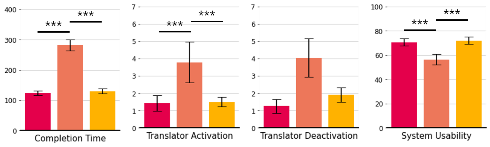
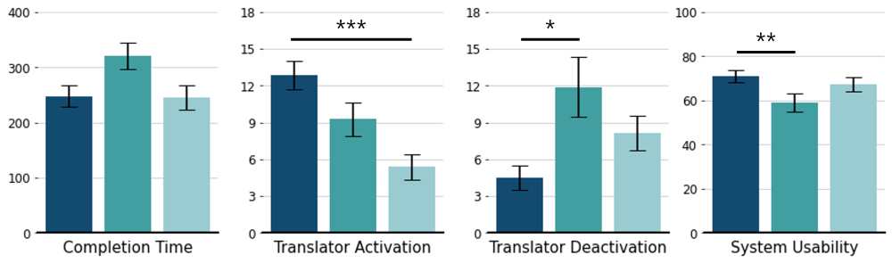
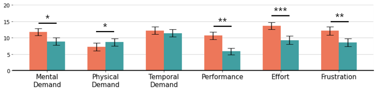

### 1. Overview
> 💡 Non-IX와 IX, 두 실험을 통해 수집한 사용자 데이터를 기반으로 통계 검정을 수행하고, 분석 결과를 시각화

&nbsp;

◼︎ **Analysis Overview**
* within-subject 사용자 실험을 통해 수집한 데이터에 대해 통계 분석  막대그래프 시각화를 수행
* 각 실험은 세 가지 조건(Otext, Owidget, Itext)으로 구성
* 분석은 두 가지 관점에서 진행
    * 조건 간 비교: 한 지표 내에서 Otext vs. Owidget vs. Itext
    * Non-IX vs. IX 비교: 각 지표 별로 두 데이터를 짝지어 비교
* 분석 데이터 : 분석 데이터: NASA-TLX(0–20), UEQ(-3–3), Flow State Scale(1–7), Other_Readability(1–7), Other_TCT(ms 단위) 등

<br/> 

### 2. Configuration

◼︎ **Architecture**
```text
./
│
├── data/
|   ├── IX-results.csv
|   └── NonIX-results.csv
|
├── img/
|
├── draw_fig.py
├── draw_fig_nonix-ix.py
├── stat.py
└── stat_nonix-ix.py
```

◼︎ **조건 간 통계 분석 `stat.py`**
1. **정규성 검정**: Shapiro-Wilk 검정을 통해 각 조건 데이터의 정규성을 확인
2. **전체 조건 비교**: 정규성을 만족하는 경우 Repeated Measures ANOVA, 그렇지 않는 경우 Friedman 검정을 수행
3. **사후 검정**: 정규성을 만족하는 경우 Paired t-test와 Bonferroni 보정을 적용, 그렇지 않은 경우 Conover 검정을 수행
4. **효과 크기 계산**: Cohen's d 또는 Cliff's Delta를 계산

◼︎ **Non-IX vs. IX 짝 비교 `stat_nonix-ix.py`**
* 두 CSV를 Pid 기준으로 병합한 뒤, 각 지표 및 조건별로 IX와 Non-IX 데이터를 비교
1. 차이 점수(IX-Non-IX)에 대한 Shapiro-Wilk 정규성 검정
2. 정규성을 만족하는 경우 Paired t-test, 그렇지 않은 경우 Wilcoxon signed-rank 수행

◼︎ **지표별 막대 그래프 시각화 `draw_fig.py`**
* 한 평가 지표에 대해 O.Text, O.Widget, I.Text 세 조건의 평균 ± 표준오차 막대그래프를 PNG로 저장
* 분석할 지표: 코드의 `measure` 변수를 수정 (ex; `UEQ_Attractive`)
* 색상: Non-IX/IX 팔레트 중 사용할 코드의 주석을 전환
* 축 눈금, 라벨(지표명): `plt.yticks`와 `plt.xlabel`을 지표에 맞게 수정

◼︎ **Non-IX vs. IX 막대 그래프 시각화 `draw_fig_nonix-ix.py`**
* 지표 그룹 (NASA-TLX, Readability, Flow State Scale) 별로 Non-IX와 IX를 나란히 비교하는 막대 그래프를 PNG로 저장
* 지표 그룹 선택: 파일의 `# +` 셀 중 원하는 그룹의 셀만 실행

<br/> 

### 3. Execution
* 통계 분석
```bash
python stat.py
python stat_nonix-ix.py
```
* 막대그래프 시각화
```bash
python draw_fig.py
python draw_fig_nonix-ix.py
```
* 실행 결과를 바탕으로 구성한 데이터 시각화 예시 (유의성 표시 별도 삽입)





